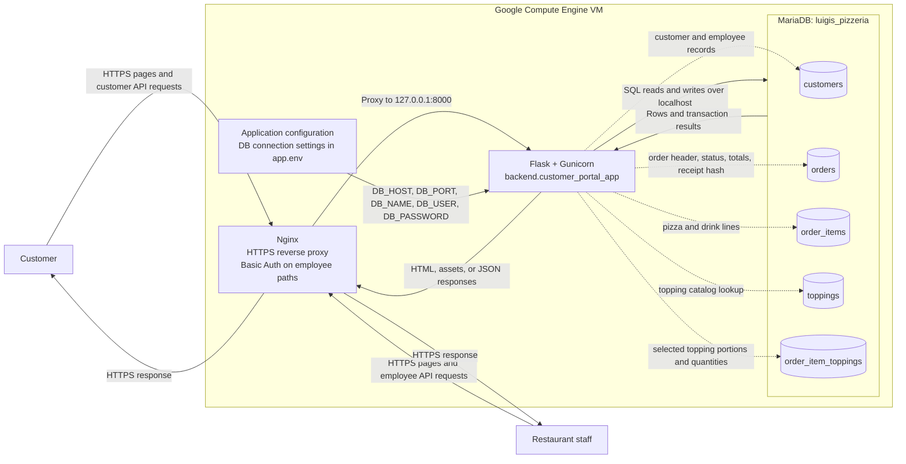

# Luigi's Pizzeria Data Flow Diagram

This diagram documents the deployed application entry point, `backend.customer_portal_app:app`, and its MariaDB database. The legacy employee-only app in `backend/app.py` is not part of this deployed flow.

## System context



## Order and status data flows

```mermaid
flowchart LR
    Customer[Customer browser]
    Employee[Employee browser]
    Proxy["Nginx<br/>employee Basic Auth"]

    subgraph Flask["Flask application: backend.customer_portal_app"]
        Menu["Serve menu<br/>from application configuration"]
        Create["Validate order<br/>calculate prices and tax"]
        Read["Load order details<br/>active queue, history, or tracker"]
        Status["Validate and update<br/>employee order status"]
    end

    subgraph DB["MariaDB: luigis_pizzeria"]
        DCustomers[(customers)]
        DOrders[(orders)]
        DItems[(order_items)]
        DToppings[(toppings)]
        DItemToppings[(order_item_toppings)]
    end

    Customer -->|GET /api/customer/menu| Proxy
    Proxy --> Menu
    Menu -->|menu, topping choices, tax rate| Customer

    Customer -->|POST /api/customer/orders<br/>contact, pickup, items, demo payment metadata| Proxy
    Employee -->|POST /api/employee/orders<br/>contact, channel, pickup, items| Proxy
    Proxy -->|employee paths require Basic Auth| Create
    Create -->|phone-keyed customer upsert| DCustomers
    Create -->|insert order header and totals| DOrders
    Create -->|insert pizza or drink lines| DItems
    Create -->|lookup topping IDs| DToppings
    Create -->|insert selected topping quantities and portions| DItemToppings
    Create -->|receipt/order JSON; customer order also gets one-time raw tracking token| Proxy
    Proxy --> Customer
    Proxy --> Employee

    Employee -->|GET /api/employee/orders or /api/employee/order-history| Proxy
    Proxy --> Read
    Read -->|select headers joined with customers| DOrders
    Read --> DCustomers
    Read -->|select line items| DItems
    Read -->|join selected toppings to catalog| DItemToppings
    Read --> DToppings
    Read -->|assembled order JSON| Proxy
    Proxy --> Employee

    Employee -->|PATCH /api/employee/orders/{id}<br/>new status| Proxy
    Proxy --> Status
    Status -->|lock/read current status, then update status and completed_at| DOrders
    Status -->|success or error JSON| Proxy
    Proxy --> Employee

    Customer -->|GET /api/customer/orders/{id}<br/>receipt token in X-Order-Token| Proxy
    Proxy --> Read
    Read -->|hash supplied token and match order ID + stored hash| DOrders
    Read -->|order status and details| Proxy
    Proxy --> Customer
```

## What the database stores

| Table | Role in the data flow |
| --- | --- |
| `customers` | Customer name and phone. A matching phone reuses the customer row when a new order is placed. |
| `orders` | One order header: source/channel, pickup time, status, notes, subtotal, tax, total, and customer portal receipt/payment metadata. |
| `order_items` | Pizza and drink lines belonging to an order, including item quantity and server-calculated unit price. |
| `toppings` | Normalized list of topping names used to associate selected toppings with order lines. |
| `order_item_toppings` | Toppings selected for a specific pizza line, including serving quantity, portion, and unit price. The schema limits each topping quantity to 1–3. |

`orders.customer_id` links an order to `customers`; `order_items.order_id` links lines to orders; `order_item_toppings` links each topping selection to an order line and a topping. Foreign keys enforce these relationships.

## Important implementation details

- The browser gets its menu, base prices, topping prices, and tax rate from Flask's application configuration. The menu is not queried from MariaDB. MariaDB's `toppings` table is used when saving and reading selected toppings.
- Flask validates incoming data and calculates prices and tax on the server. It saves a new order, its line items, and topping selections in one MariaDB transaction; any failure rolls the transaction back.
- For customer orders, Flask returns a random receipt token once and stores only its SHA-256 hash in `orders.tracking_token_hash`. The browser keeps the token with the receipt in local storage and presents it to the tracking endpoint. Raw card numbers and security codes are rejected; the demo flow stores only the payment method and last four digits.
- Employee pages and `/api/employee/*` requests pass through Nginx Basic Auth. MariaDB is configured for local VM access, and Flask receives database credentials through `/etc/luigi-pizzeria/app.env`.

## Main code and schema references

- API, validation, pricing, transactions, reads, receipt checks, and status updates: `backend/customer_portal_app.py`
- Deployed database tables and constraints: `database/customer_portal.sql`
- Browser API calls: `static/js/customer-portal.js` and `static/js/employee-dashboard.js`
- Nginx, systemd, and database configuration: `deploy-gce.sh`
